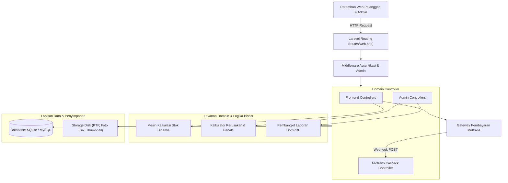
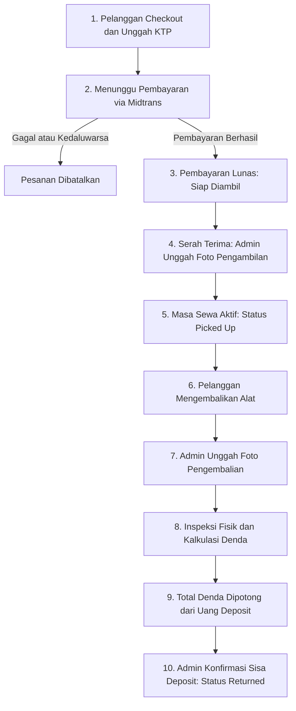
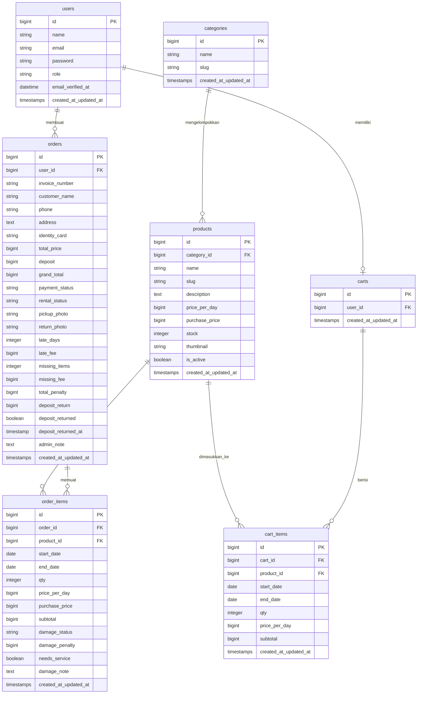

# Pemuda Berkelana

> **Platform Manajemen Inventaris dan Penyewaan Peralatan Outdoor Skala Profesional**  
> *Bahasa: [English](README.md) | **Bahasa Indonesia***

---

## Daftar Isi

- [Ringkasan Proyek](#ringkasan-proyek)
- [Fitur Utama](#fitur-utama)
  - [Storefront Pelanggan](#storefront-pelanggan)
  - [Mesin Ketersediaan Stok Dinamis](#mesin-ketersediaan-stok-dinamis)
  - [Sistem Deposit & Penilaian Denda](#sistem-deposit--penilaian-denda)
  - [Integrasi Pembayaran Midtrans](#integrasi-pembayaran-midtrans)
  - [Operasional Admin & Pelaporan](#operasional-admin--pelaporan)
- [Arsitektur Sistem](#arsitektur-sistem)
- [Siklus Hidup Transaksi & Rental](#siklus-hidup-transaksi--rental)
- [Skema Basis Data & ERD](#skema-basis-data--erd)
- [Logika Bisnis & Algoritma Inti](#logika-bisnis--algoritma-inti)
  - [1. Perhitungan Ketersediaan Stok Berdasarkan Rentang Tanggal](#1-perhitungan-ketersediaan-stok-berdasarkan-rentang-tanggal)
  - [2. Formulasi Penalti & Kerusakan Bertingkat](#2-formulasi-penalti--kerusakan-bertingkat)
  - [3. Verifikasi Tanda Tangan Webhook Midtrans](#3-verifikasi-tanda-tangan-webhook-midtrans)
- [Teknologi yang Digunakan](#teknologi-yang-digunakan)
- [Prasyarat Sistem](#prasyarat-sistem)
- [Panduan Instalasi & Pengaturan](#panduan-instalasi--pengaturan)
- [Konfigurasi Environment](#konfigurasi-environment)
- [Struktur Direktori](#struktur-direktori)
- [Pertimbangan Keamanan](#pertimbangan-keamanan)
- [Lisensi](#lisensi)

---

## Ringkasan Proyek

**Pemuda Berkelana** adalah aplikasi web sistem informasi penyewaan perlengkapan kegiatan luar ruangan (outdoor & camping gear) yang dikembangkan menggunakan **Laravel 12** dan **PHP 8.2+**. Sistem ini dirancang untuk mendigitalisasi dan mengotomatisasi seluruh siklus operasional bisnis persewaan—mulai dari reservasi stok berbasis rentang tanggal dinamis, verifikasi dokumen identitas penyewa, pembayaran otomatis melalui **Midtrans Snap**, verifikasi fisik serah terima barang berbasis foto, penilaian detail kerusakan barang berbasis harga perolehan, hingga penerbitan laporan keuangan terstandardisasi format PDF.

Platform ini mengeliminasi masalah *double-booking* menggunakan kueri interseksi rentang tanggal (*overlapping date-interval*), menjaga nilai inventaris melalui pencatatan harga beli aset (*snapshot purchase price*), serta memastikan transparansi finansial melalui rekonsiliasi uang jaminan (deposit).

---

## Fitur Utama

### Storefront Pelanggan
- **Katalog Terstruktur:** Pencarian dan penyaringan alat luar ruangan berdasarkan kategori (Tenda, Carrier, Sleeping Bag, Sepatu Gunung, Alat Masak/Nesting, Kompor).
- **Pemilihan Jadwal Interaktif:** Pemilihan rentang tanggal sewa menggunakan Flatpickr dengan pengecekan stok otomatis via AJAX.
- **Kalkulasi Biaya Transparan:** Perhitungan subtotal otomatis berdasarkan durasi hari sewa, harga harian produk, dan kuantitas barang.
- **Unggah Identitas Wajib:** Validasi pengunggahan dokumen identitas (KTP) pada formulir *checkout* untuk memitigasi risiko persewaan.
- **Portal Riwayat Pesanan:** Akses informasi langsung terkait status pembayaran, status penyewaan, rincian invoice, dan status pengembalian deposit.

### Mesin Ketersediaan Stok Dinamis
- **Alokasi Non-Linear:** Stok tidak dipotong secara permanen, melainkan dialokasikan berdasarkan interval tanggal peminjaman. Barang akan kembali berstatus tersedia secara otomatis setelah siklus pengembalian selesai.
- **Pencegahan Reservasi Bentrok:** Memverifikasi potensi tabrakan jadwal (*schedule collision*) secara akurat sebelum pesanan dikonfirmasi.
- **Validasi Dua Tahap:** Validasi ketersediaan barang dijalankan di sisi klien (AJAX) dan dievaluasi ulang di sisi server (*server-side transaction validation*) saat *checkout*.

### Sistem Deposit & Penilaian Denda
- **Uang Jaminan Wajib:** Penarikan uang jaminan (deposit default Rp 100.000) pada setiap transaksi sebagai pengaman aset.
- **Kalkulasi Denda Multifaktor:**
  - **Denda Keterlambatan:** Dihitung flat per hari keterlambatan (Rp 50.000/hari).
  - **Denda Kehilangan Komponen:** Dihitung flat per unit komponen yang hilang (Rp 5.000/item).
  - **Ganti Rugi Kerusakan:** Dihitung secara proporsional dari snapshot harga beli aset saat transaksi dibuat.
- **Pemotongan Deposit Otomatis:** Akumulasi seluruh denda otomatis dipotong dari saldo deposit, dengan pencatatan status pengembalian dana (*refund confirmation*).

### Integrasi Pembayaran Midtrans
- **Midtrans Snap Modal:** Dukungan pembayaran *cashless* terintegrasi meliputi Virtual Account Bank, QRIS, E-Wallet (GoPay, ShopeePay), dan Kartu Kredit.
- **Penanganan Webhook Aman:** Endpoint callback dilengkapi validasi tanda tangan kriptografi SHA-512 untuk mencegah manipulasi data pembayaran.
- **Otomatisasi Perubahan Status:** Status pesanan bertransisi otomatis dari `pending` ke `paid` dan status rental berubah ke `ready` (siap diambil) segera setelah dana terverifikasi oleh payment gateway.

### Operasional Admin & Pelaporan
- **Dashboard Analitik Eksekutif:** Visualisasi metrik bisnis utama: *Gross Merchandise Value* (GMV), pendapatan sewa, total deposit tertahan, denda terkumpul, status pemeliharaan unit, dan produk terlaris.
- **Protokol Verifikasi Serah Terima:**
  - Penyerahan unit (`picked_up`) mewajibkan admin mengunggah foto kondisi saat barang diambil (`pickup_photo`).
  - Pengembalian unit (`returned`) mewajibkan inspeksi fisik per item serta dokumentasi foto akhir (`return_photo`).
- **Pelaporan Dokumen PDF:** Ekspor laporan rekapitulasi keuangan dan inventaris berorientasi *landscape* ukuran A4 menggunakan pustaka `barryvdh/laravel-dompdf`.

---

## Arsitektur Sistem



---

## Siklus Hidup Transaksi & Rental



---

## Skema Basis Data & ERD



---

## Logika Bisnis & Algoritma Inti

### 1. Perhitungan Ketersediaan Stok Berdasarkan Rentang Tanggal

Pada sistem penyewaan, kuantitas stok barang tidak boleh berkurang secara permanen. Barang akan kembali berstatus tersedia setelah jadwal peminjaman berakhir. Ketersediaan dihitung dinamis menggunakan logika pengecekan tabrakan rentang tanggal pada `App\Models\Product::availableStock`:

```php
public function availableStock(string $startDate, string $endDate): int
{
    $bookedQty = OrderItem::query()
        ->where('product_id', $this->id)
        ->whereHas('order', function ($query) {
            $query->where('payment_status', Order::PAYMENT_PAID)
                  ->whereNotIn('rental_status', [
                      Order::RENTAL_RETURNED,
                      Order::RENTAL_CANCELLED,
                  ]);
        })
        ->where(function ($query) use ($startDate, $endDate) {
            $query->whereBetween('start_date', [$startDate, $endDate])
                  ->orWhereBetween('end_date', [$startDate, $endDate])
                  ->orWhere(function ($q) use ($startDate, $endDate) {
                      $q->where('start_date', '<=', $startDate)
                        ->where('end_date', '>=', $endDate);
                  });
        })
        ->sum('qty');

    return max(0, $this->stock - $bookedQty);
}
```

### 2. Formulasi Penalti & Kerusakan Bertingkat

Saat proses pengembalian berlangsung (`AdminOrderController::returnProcess`), kondisi setiap barang dievaluasi terhadap harga perolehannya (`purchase_price`):

```text
Denda Kerusakan Item = (Harga Beli Aset x Persentase Kerusakan) x Kuantitas
```

| Kondisi Barang | Persentase Denda | Deskripsi Teknis |
| :--- | :---: | :--- |
| `good` | **0%** | Kondisi prima tanpa kerusakan fungsional maupun estetika |
| `light` | **20%** | Kerusakan minor atau kotor berlebih yang memerlukan perbaikan ringan |
| `medium` | **50%** | Kerusakan sedang yang membutuhkan servis profesional atau penggantian suku cadang |
| `heavy` | **100%** | Kerusakan fatal/patah/robek sehingga unit dinyatakan tidak layak pakai |
| `lost` | **100%** | Unit hilang sepenuhnya; penggantian penuh senilai harga beli barang |

Rekonsiliasi denda terhadap uang deposit:

```text
Denda Keterlambatan   = Jumlah Hari Telat x Rp 50.000
Denda Komponen Hilang = Jumlah Item Hilang x Rp 5.000
Total Denda           = Denda Keterlambatan + Denda Komponen Hilang + Total Denda Kerusakan
Sisa Deposit          = MAX(0, Uang Deposit - Total Denda)
```

### 3. Verifikasi Tanda Tangan Webhook Midtrans

Untuk melindungi sistem dari *request spoofing*, setiap notifikasi dari Midtrans diverifikasi menggunakan enkripsi hash SHA-512 pada `App\Http\Controllers\MidtransCallbackController`:

```php
$signatureSource = $request->order_id . $request->status_code . $request->gross_amount . config('midtrans.server_key');
$expectedSignature = hash('sha512', $signatureSource);

if ($expectedSignature !== $request->signature_key) {
    return response()->json(['message' => 'Invalid signature'], 403);
}
```

---

## Teknologi yang Digunakan

- **Backend Framework:** Laravel 12.x
- **Lingkungan Eksekusi:** PHP 8.2 atau lebih baru
- **Basis Data:** SQLite (bawaan pengembangan) atau MySQL 8.0+ / MariaDB
- **Frontend:** Blade Template, Tailwind CSS, Alpine.js, Flatpickr
- **Peralatan Build:** Vite 7.x, PostCSS, Autoprefixer
- **Pustaka Eksternal:**
  - `midtrans/midtrans-php` (v2.6) – Integrasi gateway pembayaran
  - `barryvdh/laravel-dompdf` (v3.1) – Pembangkit dokumen laporan PDF

---

## Prasyarat Sistem

Sebelum melakukan pengaturan repositori, pastikan dependensi berikut terpasang di komputer atau server Anda:

- **PHP** >= 8.2 beserta ekstensi: `pdo`, `mbstring`, `openssl`, `tokenizer`, `xml`, `ctype`, `json`, `gd`
- **Composer** >= 2.6
- **Node.js** >= 18.x & **npm** >= 9.x
- **Git**

---

## Panduan Instalasi & Pengaturan

Lakukan langkah-langkah berikut untuk mengonfigurasi dan menjalankan aplikasi di lingkungan lokal:

### 1. Kloning Repositori
```bash
git clone https://github.com/anggixz/outdoor-rental-system.git
cd outdoor-rental-system
```

### 2. Instal Dependensi PHP
```bash
composer install
```

### 3. Instal Dependensi Frontend
```bash
npm install
```

### 4. Konfigurasi Berkas Environment
Salin template berkas environment dan sesuaikan parameternya:
```bash
cp .env.example .env
```

Buat kunci enkripsi aplikasi:
```bash
php artisan key:generate
```

### 5. Buat Symlink Storage Publik
Tautkan direktori penyimpanan privat ke direktori publik agar gambar dapat diakses oleh browser:
```bash
php artisan storage:link
```

### 6. Jalankan Migrasi & Seeder Database
Eksekusi migrasi tabel dan masukkan data bawaan kategori produk:
```bash
php artisan migrate --seed
```

### 7. Kompilasi Aset Frontend
```bash
# Mode pengembangan (HMR):
npm run dev

# Kompilasi rilis produksi:
npm run build
```

### 8. Jalankan Server Aplikasi
```bash
php artisan serve
```
Aplikasi kini dapat diakses melalui peramban di alamat `http://127.0.0.1:8000`.

---

## Konfigurasi Environment

Pastikan variabel-variabel berikut dikonfigurasi dengan tepat di dalam berkas `.env`:

```dotenv
APP_NAME="Pemuda Berkelana"
APP_ENV=local
APP_KEY=base64:...
APP_DEBUG=true
APP_URL=http://localhost:8000

# Konfigurasi Basis Data (Bawaan SQLite)
DB_CONNECTION=sqlite
# Opsi alternatif menggunakan MySQL:
# DB_CONNECTION=mysql
# DB_HOST=127.0.0.1
# DB_PORT=3306
# DB_DATABASE=pemuda_berkelana
# DB_USERNAME=root
# DB_PASSWORD=

# Konfigurasi Storage
FILESYSTEM_DISK=public

# Konfigurasi Gateway Pembayaran Midtrans
MIDTRANS_SERVER_KEY="server-key-midtrans-anda"
MIDTRANS_CLIENT_KEY="client-key-midtrans-anda"
MIDTRANS_IS_PRODUCTION=false
```

> **Catatan Pengujian Webhook Lokal:** Ketika menguji notifikasi pembayaran Midtrans di komputer lokal, gunakan terowongan HTTP seperti **ngrok**:  
> `ngrok http 8000`  
> Kemudian arahkan Notification URL pada Midtrans Merchant Dashboard ke:  
> `https://<subdomain-ngrok-anda>.ngrok-free.app/midtrans/callback`

---

## Struktur Direktori

```text
PemudaBerkelana/
├── app/
│   ├── Http/
│   │   ├── Controllers/
│   │   │   ├── Admin/                # Controller operasional admin (Dashboard, Orders, Products, Reports, Users)
│   │   │   ├── Auth/                 # Controller autentikasi Laravel Breeze
│   │   │   ├── Frontend/             # Controller antarmuka pelanggan (Products, Cart, Checkout, Orders, Payment)
│   │   │   ├── HomeController.php    # Controller halaman beranda
│   │   │   └── MidtransCallbackController.php # Pemroses webhook notifikasi pembayaran
│   │   └── Middleware/
│   │       └── AdminMiddleware.php   # Proteksi hak akses route khusus administrator
│   └── Models/                       # Eloquent Model (Order, OrderItem, Product, Cart, dll.)
├── bootstrap/
│   └── app.php                       # Pendaftaran middleware & pengecualian CSRF callback
├── config/
│   └── midtrans.php                  # Konfigurasi kredensial Midtrans
├── database/
│   ├── migrations/                   # Berkas skema tabel database
│   └── seeders/                      # Seeder data awal (CategorySeeder, DatabaseSeeder)
├── public/                           # Document root server web
├── resources/
│   ├── css/                          # Berkas gaya stylesheet Tailwind
│   ├── js/                           # Berkas JavaScript utama
│   └── views/
│       ├── admin/                    # Template tampilan panel kontrol admin
│       ├── auth/                     # Template autentikasi pengguna
│       ├── frontend/                 # Template antarmuka katalog & checkout pelanggan
│       └── layouts/                  # Kerangka layout utama aplikasi
├── routes/
│   ├── auth.php                      # Definisi rute autentikasi
│   └── web.php                       # Definisi rute utama web aplikasi
└── storage/
    └── app/public/                   # Berkas media tersimpan (KTP, foto serah terima, foto pengembalian, thumbnail)
```

---

## Pertimbangan Keamanan

1. **Role-Based Access Control (RBAC):** Seluruh modul panel admin diisolasi di balik `AdminMiddleware`. Upaya akses oleh pengguna non-admin atau pengguna anonim langsung ditolak dengan status HTTP 403 Forbidden.
2. **Pencegahan Horizontal Privilege Escalation:** Endpoint data pelanggan (`/orders/{order}`, `/payment/{order}`) menerapkan pemeriksaan kepemilikan ketat (`abort_if((int) $order->user_id !== (int) auth()->id(), 403)`).
3. **Pengecualian CSRF Terarah:** Route `/midtrans/callback` dikecualikan dari verifikasi token CSRF di `bootstrap/app.php` khusus untuk menerima sinyal HTTP POST dari Midtrans, yang keamanannya dijamin oleh verifikasi tanda tangan kriptografi SHA-512.
4. **Validasi File & Batasan Ukuran:** Pengunggahan berkas KTP dan foto kondisi fisik barang diwajibkan berupa format citra terverifikasi (`jpg`, `jpeg`, `png`, `webp`) dengan batas maksimal 4096 KB.

---

## Lisensi

Proyek ini didistribusikan di bawah lisensi [GNU Affero General Public License v3.0 (AGPL-3.0)](LICENSE).
