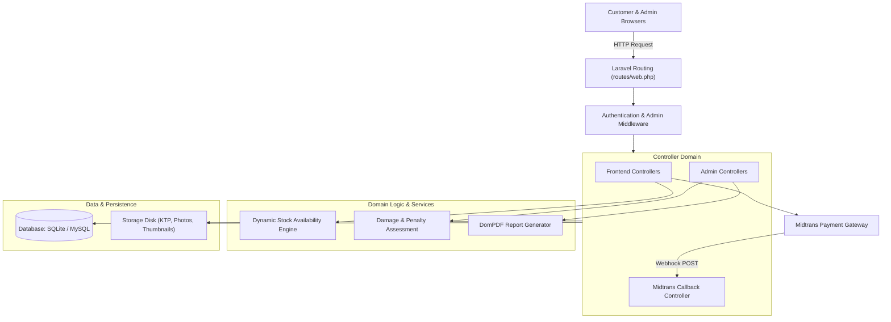
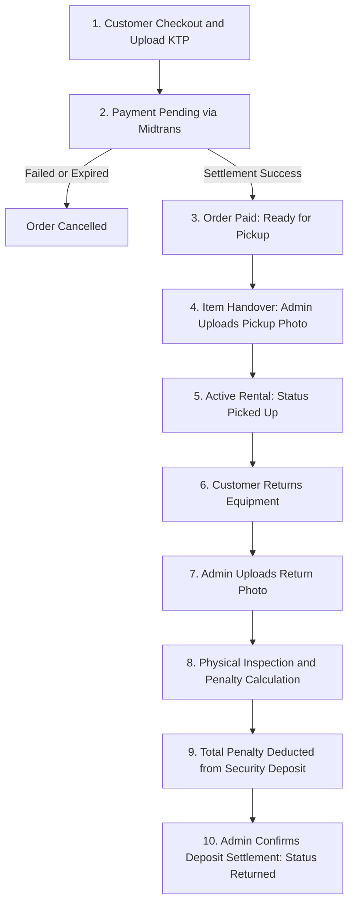
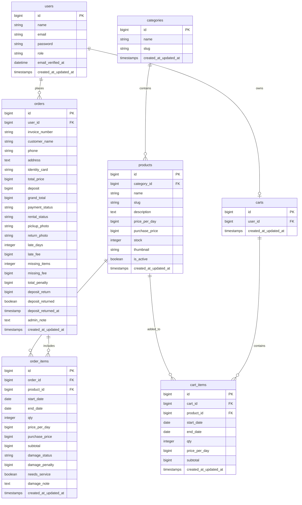

# Pemuda Berkelana

> **Enterprise-Grade Outdoor Equipment Rental and Inventory Management Platform**  
> *Language: **English** | [Bahasa Indonesia](README.id.md)*

---

## Table of Contents

- [Overview](#overview)
- [Key Features](#key-features)
  - [Customer Storefront](#customer-storefront)
  - [Inventory & Dynamic Availability Engine](#inventory--dynamic-availability-engine)
  - [Deposit & Penalty Assessment System](#deposit--penalty-assessment-system)
  - [Midtrans Payment Integration](#midtrans-payment-integration)
  - [Administrative Operations & Reporting](#administrative-operations--reporting)
- [System Architecture](#system-architecture)
- [Rental & Transaction Lifecycle](#rental--transaction-lifecycle)
- [Database Schema & ERD](#database-schema--erd)
- [Core Business Logic & Algorithms](#core-business-logic--algorithms)
  - [1. Dynamic Overlap Availability Calculation](#1-dynamic-overlap-availability-calculation)
  - [2. Multi-Tier Damage & Penalty Formulation](#2-multi-tier-damage--penalty-formulation)
  - [3. Midtrans Webhook Signature Verification](#3-midtrans-webhook-signature-verification)
- [Technology Stack](#technology-stack)
- [Prerequisites](#prerequisites)
- [Installation & Setup](#installation--setup)
- [Environment Configuration](#environment-configuration)
- [Directory Structure](#directory-structure)
- [Security Considerations](#security-considerations)
- [License](#license)

---

## Overview

**Pemuda Berkelana** is a full-featured outdoor equipment rental application developed on **Laravel 12** and **PHP 8.2+**. The system manages the entire operational lifecycle of outdoor gear leasing—from dynamic date-range inventory reservations and identity verification to automated payment handling via **Midtrans Snap**, mandatory photo-verified handover protocols, granular asset damage assessments, and audit-ready PDF financial statements.

Designed for operational precision, the platform eliminates double-booking issues through overlapping date-interval queries, protects rental inventory value via asset acquisition price snapshots, and guarantees financial transparency through security deposit reconciliation.

---

## Key Features

### Customer Storefront
- **Interactive Catalog:** Filter and search outdoor gear across categories (Tents, Carriers, Sleeping Bags, Mountain Boots, Cookware, Stoves).
- **Date-Range Reservation Picker:** Real-time scheduling using Flatpickr with asynchronous availability queries.
- **Cart & Subtotal Breakdown:** Calculates duration in days multiplied by daily rental rates and item quantities.
- **Identity Verification Upload:** Required identity card (KTP) upload during checkout to mitigate leasing risks.
- **Customer Dashboard:** Real-time visibility into rental statuses, invoice records, and deposit settlement timelines.

### Inventory & Dynamic Availability Engine
- **Non-Linear Stock Allocation:** Inventory is booked against date intervals rather than decremented statically. Units return to available status dynamically based on return timestamps.
- **Overlapping Booking Protection:** Validates against simultaneous reservations during date collisions before order commitment.
- **Dual-Phase Stock Validation:** Availability is verified both in the user interface via AJAX and re-validated server-side during the checkout transaction.

### Deposit & Penalty Assessment System
- **Mandatory Security Deposit:** Default deposit (e.g., IDR 100,000) collected up front at checkout.
- **Multi-Factor Penalty Calculator:**
  - **Overdue Penalties:** Fixed daily late charges (IDR 50,000/day).
  - **Missing Item Charges:** Fixed rate per missing unit (IDR 5,000/accessory).
  - **Asset Damage Restitution:** Calculated dynamically using the asset's purchase price snapshot captured at transaction time.
- **Automatic Deposit Netting:** Penalties are automatically deducted from the held deposit, with explicit logging of refunds and bank transfers.

### Midtrans Payment Integration
- **Midtrans Snap Modal:** Integrated in-app payment gateway supporting Bank Transfers, Virtual Accounts, QRIS, E-Wallets, and Credit Cards.
- **Idempotent Webhook Handler:** Secure callback endpoint with SHA-512 signature hash validation.
- **Automated State Transitions:** Instant transition from `pending` to `paid` and `ready` for pickup upon payment capture or settlement.

### Administrative Operations & Reporting
- **Executive KPI Dashboard:** Real-time monitoring of Gross Merchandise Value (GMV), rental revenue, held deposits, total penalties collected, fleet maintenance status, and best-selling assets.
- **Handover Verification Protocols:**
  - Handover confirmation requires mandatory upload of pickup condition photography (`pickup_photo`).
  - Return check-in requires itemized physical inspection and return photography (`return_photo`).
- **Comprehensive PDF Reporting:** Export filterable, landscape-oriented A4 audit reports powered by `barryvdh/laravel-dompdf`.

---

## System Architecture



---

## Rental & Transaction Lifecycle



---

## Database Schema & ERD



---

## Core Business Logic & Algorithms

### 1. Dynamic Overlap Availability Calculation

Conventional e-commerce stores decrement inventory permanently on purchase. In rental operations, units return to circulation after their leasing interval. Availability is calculated dynamically via interval collision logic in `App\Models\Product::availableStock`:

```php
public function availableStock(string $startDate, string $endDate): int
{
    $bookedQty = OrderItem::query()
        ->where('product_id', $this->id)
        ->whereHas('order', function ($query) {
            $query->where('payment_status', Order::PAYMENT_PAID)
                  ->whereNotIn('rental_status', [
                      Order::RENTAL_RETURNED,
                      Order::RENTAL_CANCELLED,
                  ]);
        })
        ->where(function ($query) use ($startDate, $endDate) {
            $query->whereBetween('start_date', [$startDate, $endDate])
                  ->orWhereBetween('end_date', [$startDate, $endDate])
                  ->orWhere(function ($q) use ($startDate, $endDate) {
                      $q->where('start_date', '<=', $startDate)
                        ->where('end_date', '>=', $endDate);
                  });
        })
        ->sum('qty');

    return max(0, $this->stock - $bookedQty);
}
```

### 2. Multi-Tier Damage & Penalty Formulation

During the return process (`AdminOrderController::returnProcess`), each item's condition is evaluated against its snapshot acquisition value (`purchase_price`):

```text
Item Damage Penalty = (Purchase Price x Condition Percentage) x Quantity
```

| Condition Status | Assessment Percentage | Description |
| :--- | :---: | :--- |
| `good` | **0%** | Gear returned in pristine operational state |
| `light` | **20%** | Minor superficial or cosmetic wear requiring cleaning or touch-up |
| `medium` | **50%** | Substantial degradation needing professional repair or replacement parts |
| `heavy` | **100%** | Severe structural damage; equipment declared non-functional |
| `lost` | **100%** | Complete failure to return unit; replacement reimbursement |

Total penalties and deposit reconciliation:

```text
Late Fee       = Overdue Days x IDR 50,000
Missing Fee    = Missing Items x IDR 5,000
Total Penalty  = Late Fee + Missing Fee + Total Damage Penalties
Deposit Return = MAX(0, Security Deposit - Total Penalty)
```

### 3. Midtrans Webhook Signature Verification

To guard against spoofed callbacks, incoming Midtrans notifications are authenticated with SHA-512 cryptographic verification in `App\Http\Controllers\MidtransCallbackController`:

```php
$signatureSource = $request->order_id . $request->status_code . $request->gross_amount . config('midtrans.server_key');
$expectedSignature = hash('sha512', $signatureSource);

if ($expectedSignature !== $request->signature_key) {
    return response()->json(['message' => 'Invalid signature'], 403);
}
```

---

## Technology Stack

- **Server Framework:** Laravel 12.x
- **Runtime Environment:** PHP 8.2 or later
- **Database Engine:** SQLite (default / development) or MySQL 8.0+ / MariaDB
- **Frontend Layer:** Blade Templating Engine, Tailwind CSS, Alpine.js, Flatpickr
- **Build Tools:** Vite 7.x, PostCSS, Autoprefixer
- **Third-Party Libraries:**
  - `midtrans/midtrans-php` (v2.6) – Payment gateway communication
  - `barryvdh/laravel-dompdf` (v3.1) – Server-side PDF generation

---

## Prerequisites

Before setting up the repository, ensure the following dependencies are installed on your workstation or host server:

- **PHP** >= 8.2 with extensions: `pdo`, `mbstring`, `openssl`, `tokenizer`, `xml`, `ctype`, `json`, `gd`
- **Composer** >= 2.6
- **Node.js** >= 18.x & **npm** >= 9.x
- **Git**

---

## Installation & Setup

Follow these steps to configure and run the application locally:

### 1. Clone Repository
```bash
git clone https://github.com/anggixz/outdoor-rental-system.git
cd outdoor-rental-system
```

### 2. Install PHP Dependencies
```bash
composer install
```

### 3. Install Frontend Dependencies
```bash
npm install
```

### 4. Configure Environment
Duplicate the environment template and configure local parameters:
```bash
cp .env.example .env
```

Generate the cryptographic application encryption key:
```bash
php artisan key:generate
```

### 5. Create Storage Symlink
Expose uploaded media (thumbnails, identity cards, handover photos) to the public web root:
```bash
php artisan storage:link
```

### 6. Run Database Migrations & Seeders
Execute database migrations and seed default product categories:
```bash
php artisan migrate --seed
```

### 7. Compile Frontend Assets
```bash
# Development mode with hot module replacement:
npm run dev

# Production distribution build:
npm run build
```

### 8. Run Development Server
```bash
php artisan serve
```
The application will be accessible at `http://127.0.0.1:8000`.

---

## Environment Configuration

Configure the relevant variables in your `.env` file:

```dotenv
APP_NAME="Pemuda Berkelana"
APP_ENV=local
APP_KEY=base64:...
APP_DEBUG=true
APP_URL=http://localhost:8000

# Database Configuration (SQLite default)
DB_CONNECTION=sqlite
# Alternatively for MySQL:
# DB_CONNECTION=mysql
# DB_HOST=127.0.0.1
# DB_PORT=3306
# DB_DATABASE=pemuda_berkelana
# DB_USERNAME=root
# DB_PASSWORD=

# Filesystem Storage
FILESYSTEM_DISK=public

# Midtrans Payment Gateway Configuration
MIDTRANS_SERVER_KEY="your-midtrans-server-key"
MIDTRANS_CLIENT_KEY="your-midtrans-client-key"
MIDTRANS_IS_PRODUCTION=false
```

> **Webhook Local Testing Notice:** When evaluating Midtrans payment callbacks locally, use an HTTP tunnel such as **ngrok** to route callbacks to your local address:  
> `ngrok http 8000`  
> Update the Notification URL in your Midtrans Merchant Portal to:  
> `https://<your-ngrok-subdomain>.ngrok-free.app/midtrans/callback`

---

## Directory Structure

```text
PemudaBerkelana/
├── app/
│   ├── Http/
│   │   ├── Controllers/
│   │   │   ├── Admin/                # Administrative controllers (Dashboard, Orders, Products, Reports, Users)
│   │   │   ├── Auth/                 # Breeze authentication controllers
│   │   │   ├── Frontend/             # Customer-facing controllers (Products, Cart, Checkout, Orders, Payment)
│   │   │   ├── HomeController.php    # Landing page controller
│   │   │   └── MidtransCallbackController.php # Webhook notification processor
│   │   └── Middleware/
│   │       └── AdminMiddleware.php   # RBAC protection for admin routes
│   └── Models/                       # Eloquent models (Order, OrderItem, Product, Cart, etc.)
├── bootstrap/
│   └── app.php                       # Middleware registration & CSRF whitelist config
├── config/
│   └── midtrans.php                  # Midtrans credential bindings
├── database/
│   ├── migrations/                   # Table schema definitions
│   └── seeders/                      # Database seeders (CategorySeeder, DatabaseSeeder)
├── public/                           # Web server document root
├── resources/
│   ├── css/                          # CSS stylesheets (Tailwind)
│   ├── js/                           # JavaScript entrypoints
│   └── views/
│       ├── admin/                    # Administrative dashboard and resource views
│       ├── auth/                     # Authentication views (Login, Register, etc.)
│       ├── frontend/                 # Customer storefront and checkout views
│       └── layouts/                  # Base layout templates
├── routes/
│   ├── auth.php                      # Authentication route definitions
│   └── web.php                       # Core application route definitions
└── storage/
    └── app/public/                   # Uploaded media (identity-cards, pickup-photos, return-photos, products)
```

---

## Security Considerations

1. **Role-Based Access Control (RBAC):** Administrative resources are segregated behind the `admin` middleware. Any unauthenticated or non-admin access attempt is terminated with HTTP 403 Forbidden.
2. **Horizontal Privilege Escalation Protection:** All customer-facing endpoints (`/orders/{order}`, `/payment/{order}`) evaluate ownership using strict identity constraints (`abort_if((int) $order->user_id !== (int) auth()->id(), 403)`).
3. **Selective CSRF Exemption:** The Midtrans callback URI `/midtrans/callback` is explicitly exempted from CSRF verification in `bootstrap/app.php` to receive asynchronous HTTP webhooks, guarded instead by SHA-512 signature hashing.
4. **Input Validation & Sanitization:** Strict image MIME-type validation (`jpg`, `jpeg`, `png`, `webp`) and file size ceilings (max 4096 KB) apply to user identity uploads and equipment inspection photography.

---

## License

This software is distributed under the [GNU Affero General Public License v3.0 (AGPL-3.0)](LICENSE).
